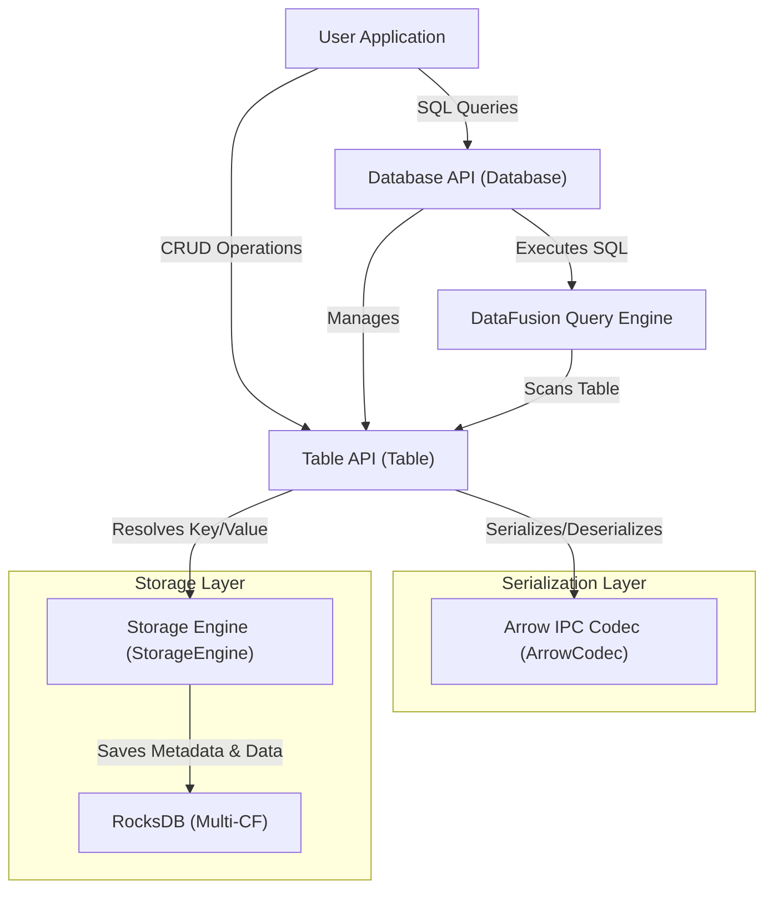
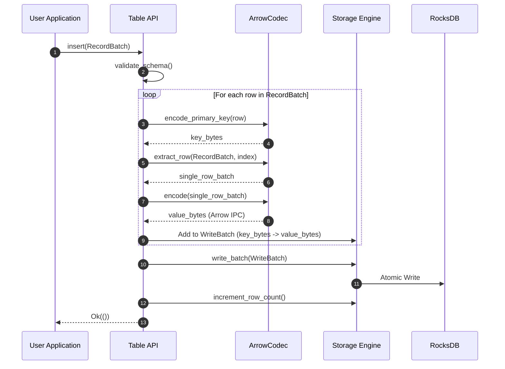
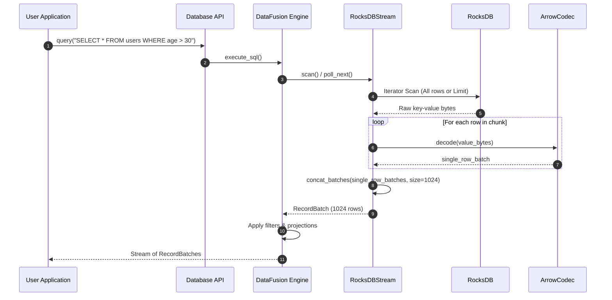

# FusionDB

[](https://www.rust-lang.org/)
[](LICENSE)

An embedded, serverless database engine written in Rust. FusionDB integrates **Apache DataFusion** as its SQL query engine, **RocksDB** as its persistent storage engine, and **Apache Arrow IPC** as its binary serialization format. 

It is designed for applications that require the analytical power of Apache Arrow and DataFusion, combined with the point-lookup efficiency and durability of RocksDB, all embedded directly into a Rust application without running a separate database server.

---

## Key Features

- 🚀 **Serverless & Embedded**: Runs directly within your application process (no network overhead, zero configuration).
- 💾 **RocksDB Storage**: High-performance LSM-tree based persistent storage with robust write-ahead logging (WAL).
- 🏹 **Apache Arrow IPC Serialization**: Rows are stored in RocksDB as Arrow IPC Stream bytes, allowing seamless zero-copy-like integration with the Arrow ecosystem.
- 🔍 **Full SQL Engine**: Powered by Apache DataFusion. You can run full relational SQL queries directly on top of RocksDB tables.
- 🔑 **Fast Point Queries**: Custom primary key indexing mapping to RocksDB keys for O(1) / O(log n) lookups.
- 🛡️ **Type-Safe Schema Validation**: Strict schema matching and validation for inserts and updates against Arrow schemas.
- 🔄 **Thread-Safe**: Fully thread-safe architecture (`Arc<Database>`) allowing concurrent read/write transactions.

---

## System Architecture

FusionDB uses a layered architecture to bridge the gap between transactional storage (RocksDB) and analytical execution (DataFusion/Arrow).



### Components

1. **Database API (`Database`)**: The main entry point. It manages table lifecycle, loads schema metadata, and provides the execution context for DataFusion queries.
2. **Table API (`Table`)**: Manages individual tables. Performs CRUD operations (`insert`, `get`, `update`, `delete`, `scan`) on a specific RocksDB Column Family.
3. **DataFusion Query Engine**: When a SQL query is run, DataFusion parses the query into a logical plan. It resolves table references via a custom `RocksDBTableProvider` and generates a physical execution plan.
4. **Storage Engine (`StorageEngine`)**: Manages the underlying RocksDB instance. It implements multi-Column Family support (one CF per user table, plus a dedicated `__metadata__` CF) and configures performance options like MemTables, Bloom Filters, and Block Caching.
5. **Arrow IPC Codec (`ArrowCodec`)**: Encodes/decodes Arrow `RecordBatch`es to/from binary bytes using the Arrow IPC Stream format.

---

## Detailed Data Flows

### Write Path (Insert)
When you insert a `RecordBatch` into a table:
1. **Schema Validation**: The batch's schema is checked against the table's registered schema.
2. **Row Splitting**: The batch is sliced into individual single-row `RecordBatch`es.
3. **Primary Key Encoding**: The value of the primary key column for each row is encoded into binary bytes using a lexicographically sortable representation.
4. **Arrow IPC Encoding**: The single-row `RecordBatch` is serialized into binary bytes using `ArrowCodec` (via `arrow_ipc::writer::StreamWriter`).
5. **Atomic Commit**: All rows are added to a RocksDB `WriteBatch` and committed atomically.



### Read Path (SQL Query)
When you execute a SQL query:
1. DataFusion compiles the query and requests a partition scan from `RocksDBTableProvider`.
2. A physical plan `RocksDBExec` is created which spawns a `RocksDBStream`.
3. The `RocksDBStream` performs a scan on the table's RocksDB Column Family.
4. For each key-value pair retrieved, the value bytes (Arrow IPC format) are decoded back into a single-row `RecordBatch`.
5. These single-row batches are concatenated into larger chunks (defaulting to 1024 rows) using `arrow::compute::concat_batches` to form analytical-friendly batches.
6. The stream yields the resulting record batches to DataFusion's physical operators for filtering, projection, aggregation, or joining.



---

## Storage & Indexing Details

### 1. Primary Key Encoding
To ensure that RocksDB range scans match the natural order of your data types, primary keys are encoded into lexicographically sortable byte arrays (`to_be_bytes()` for big-endian encoding):
- **Integers (`Int8` - `Int64`, `UInt8` - `UInt64`)**: Encoded as big-endian bytes. This guarantees that RocksDB key comparisons (which are byte-by-byte) correctly sort numeric values.
- **Strings (`Utf8`, `LargeUtf8`)**: Stored as raw UTF-8 bytes.

### 2. Arrow IPC Representation
Each record in the database is a fully qualified Arrow `RecordBatch` containing 1 row. By using the standard Arrow IPC Stream format:
- Schema metadata is preserved.
- Binary formatting is identical to what DataFusion uses internally, minimizing CPU translation overhead during reads and writes.

### 3. Metadata Management
Table schemas and configuration details are stored as JSON in a dedicated Column Family named `__metadata__`. This keeps the schema registry isolated from actual table data, preventing namespace collisions.

---

## Quick Start

### Installation

Add `fusiondb` to your `Cargo.toml`:
```toml
[dependencies]
fusiondb = { path = "./fusiondb" } # Path to the library
arrow = { version = "55", features = ["ipc"] }
arrow-array = "55"
```

### Basic CRUD and SQL Example

```rust
use fusiondb::{Database, SchemaBuilder, DataType};
use arrow_array::{Int64Array, StringArray};
use std::sync::Arc;

#[tokio::main]
async fn main() -> fusiondb::Result<()> {
    // 1. Open or create the database
    let db = Database::open("./my_database")?;

    // 2. Define the schema (primary key is required)
    let schema = SchemaBuilder::new()
        .field("id", DataType::Int64, false).primary_key()
        .field("name", DataType::Utf8, false)
        .field("age", DataType::Int64, true)
        .build()?;

    // 3. Create the table
    let table = db.create_table("users", schema)?;

    // 4. Insert data using an Arrow RecordBatch
    let batch = arrow_array::RecordBatch::try_new(
        table.arrow_schema(),
        vec![
            Arc::new(Int64Array::from(vec![1, 2, 3])),
            Arc::new(StringArray::from(vec!["Alice", "Bob", "Charlie"])),
            Arc::new(Int64Array::from(vec![Some(30), Some(25), None])),
        ],
    ).unwrap();
    table.insert(batch)?;

    // 5. Query a single row by Primary Key
    let row = table.get(2i64)?;
    println!("Fetched Row: {:?}", row);

    // 6. Run SQL queries using Apache DataFusion
    let results = db.query("SELECT name, age FROM users WHERE age > 25")?;
    for batch in results {
        println!("Query Result: {:?}", batch);
    }

    // 7. Update a row
    let updated = arrow_array::RecordBatch::try_new(
        table.arrow_schema(),
        vec![
            Arc::new(Int64Array::from(vec![1])),
            Arc::new(StringArray::from(vec!["Alice Smith"])),
            Arc::new(Int64Array::from(vec![Some(31)])),
        ],
    ).unwrap();
    table.update(1i64, updated)?;

    // 8. Delete a row
    table.delete(2i64)?;

    println!("Total remaining rows: {}", table.count()?);
    Ok(())
}
```

---

## Internal RocksDB Optimizations

FusionDB comes out of the box with performance-tuned RocksDB configurations:
- **Bloom Filters**: Configured with 10 bits per key to reduce disk read IOPS for point-lookups (checks for non-existent keys).
- **Block Cache**: LRU block cache set to 128MB by default.
- **MemTable**: 64MB write buffer size base with up to 3 buffers allowed before flushing.
- **Compaction**: Configured to use Universal Compaction style, optimized for write-heavy workloads.
- **Mmap Reads/Writes**: Enabled by default to leverage OS page caches.

---

## Build and Test

Requirements:
- **Rust**: 1.75+ (Edition 2021)
- **C/C++ Compiler**: `msvc` (Windows), `gcc`, or `clang` (Linux/macOS)
- **CMake**: Required to compile the underlying RocksDB source code.

```bash
# Build the project
cargo build

# Run unit tests
cargo test

# Run code linter
cargo clippy -- -D warnings

# Build documentation
cargo doc --no-deps --open
```

---

## License

This project is licensed under the MIT License - see the [LICENSE](LICENSE) file for details.
